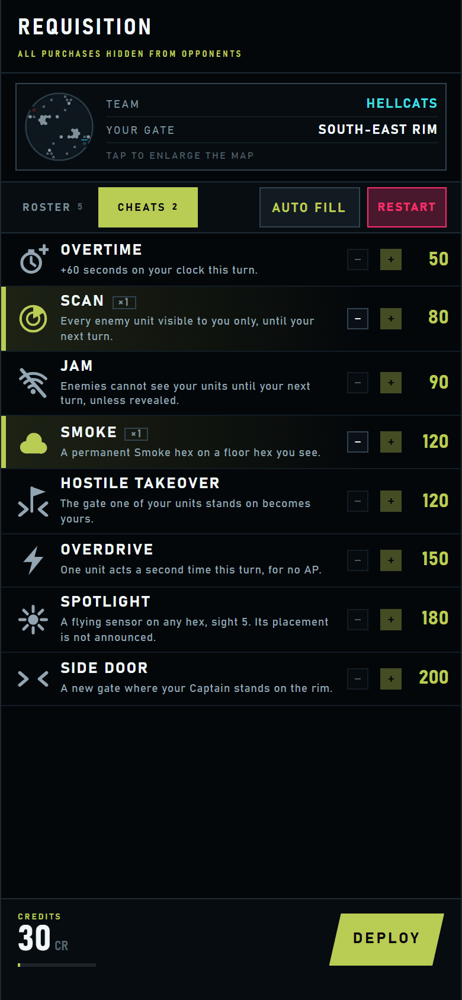
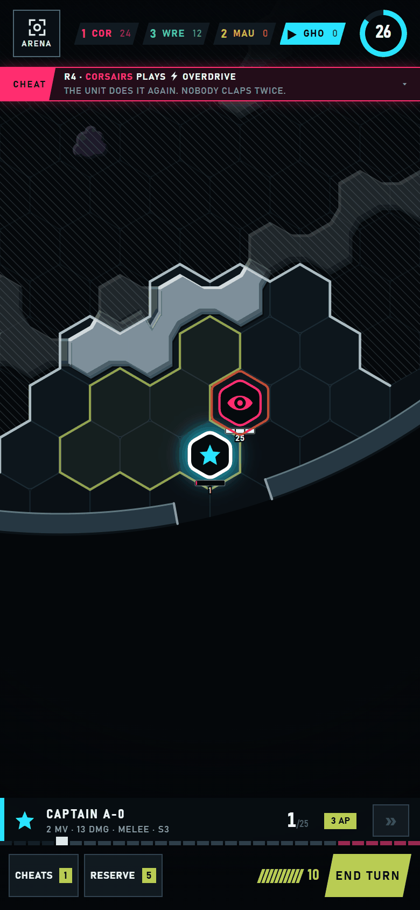
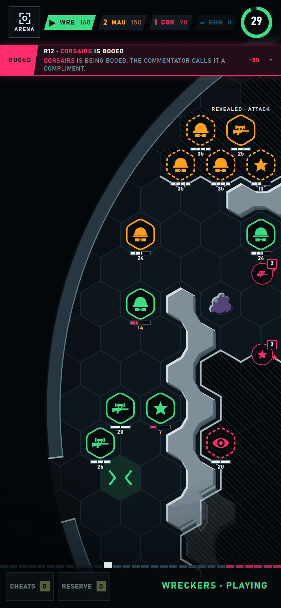
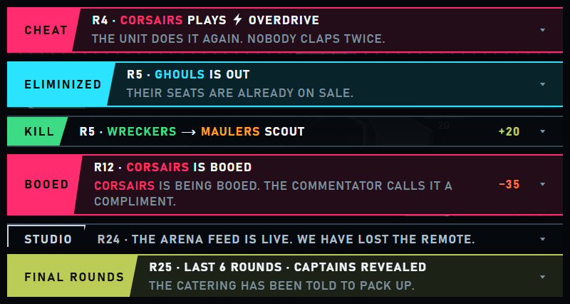
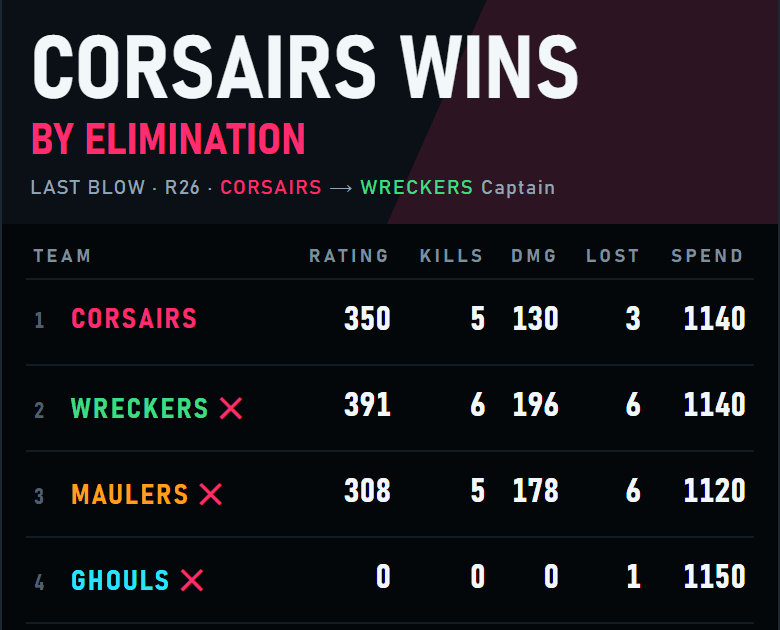

# ELIMINIZE: LIVE

*Complaints may be filed posthumously.*

A turn-based tactics game for 2 to 6 players. It runs in the browser, on a phone or a PC. 
Free to play. Heavily in development.

### [Play now, read later!](https://fiack.no/eliminize/)

&nbsp;
&nbsp;

## Information for new franchise holders

*Issued by the Ministry of Leisure.*

Congratulations on your franchise licence. The Ministry provides the arena, the cameras and the
contestants. You provide the decisions. Every match is broadcast live, and the public bets on it.

### Your roster

The contestants are convicts. The state has more of them than it can house, so they cost you nothing.
Each one signed up to fight for a shorter sentence. All rosters are voluntary. Legally.

Your captain is a veteran with enough matches behind them to be offered **contractual absolution**, a
full pardon. Nobody else on the roster gets that offer, which is why the captain is on the field at all.
Lose the captain and your team is out of the match at once, whatever else is still standing.
The Ministry calls this being *eliminized*.

### What the budget buys

Every franchise receives the same budget, because the odds must look fair. You spend it in secret,
before the match, and nobody sees what you bought until it walks into the arena.

| Unit | On file |
|---|---|
| Scout | Fast and far-sighted. Cheap eyes. |
| Trooper | The standard issue. Shoots at medium range. |
| Brute | Tough and slow, nearly blind, charges into a strike. |
| Sniper | Shoots further than it sees. Someone else spots the target. |
| Mortar | Marks a hex in plain view and shells it next turn, with splash. Fires blind. |
| Captain | Included, mandatory, fragile. Bites back in melee. |

Any unit, the captain included, can be upgraded.

The stage crew also takes favours. The Ministry calls them **cheats**. Each one breaks exactly one rule.
You may play one per turn, it costs no action points, and the feed announces which
cheat you played but never where.

| Cheat | Effect |
|---|---|
| Overtime | Additional time on your clock this turn. |
| Scan | You see every enemy unit until your next turn. |
| Jam | Enemies cannot see your units until your next turn, unless revealed. |
| Smoke | A permanent smoke hex on any floor hex you can see. |
| Hostile Takeover | The gate one of your units stands on becomes yours. |
| Overdrive | One unit acts a second time this turn, for free. |
| Spotlight | A flying sensor on any hex. Nobody is told where. |
| Side Door | A new gate wherever your captain stands on the rim. |

The requisition office also keeps seven ready-made builds on file, from Elite to Swarm.

### Match day

The arena is rebuilt for every match: a symmetric hex board in one of four sizes. Everyone sees the
terrain, but you see only the units your own units can see, and a unit that attacks gives its position away.

Your team enters through one door in the outer wall, one contestant per turn. The rest wait in the
tunnel, where nobody can count them. Standing in a rival's doorway keeps their reserve outside, and the
rules allow it.

Each turn gives you **30 seconds and 10 action points**, shared across the whole team. A unit moves or
attacks, once per turn, and unspent points are lost. There are no dice: every attack does exactly the
damage it shows.

### Ratings

The Ministry sells attention. Damage scores ratings, a kill scores more, and a captain scores the most.
A team that stops giving the cameras anything is booed, and every boo costs ratings.
In the final rounds every captain is shown to everyone. If the round limit arrives with more than one
captain alive, the highest rating wins.

Every kill, cheat and elimination goes out on the feed, with commentary. Between events you hear from
the studio, the crowd, the facilities and the sponsors.

Wreckers finished that match with the best rating, and lost. Corsairs reached their captain in round 26.

## Availability

You can play hot-seat on one device, passing it between turns, against AI
opponents at four levels (Easy, Normal, Hard and Unfair), or a mix of both. The game is built for phones
and needs no install. Matches save as you go, so you can close the tab and come back to it.

Each match stands alone: no accounts, no unlocks, no progression. Rules, balance and screens still change
between builds, and the *Dispatches* list in the game's menu says what changed.

### [Play ELIMINIZE: LIVE](https://fiack.no/eliminize/)

